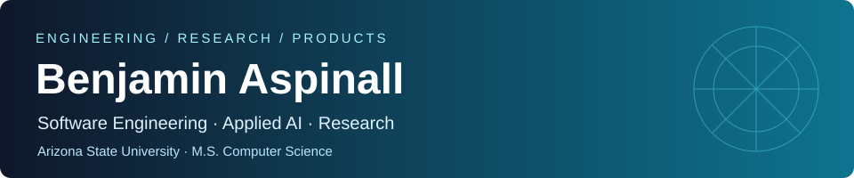

  

I build software that combines intelligent systems with practical engineering, from multi-agent research workflows to forecasting, optimization, and full-stack applications.

## Featured projects

<table>
<tr>
<td width="50%" valign="top">

### [ShipShowdown](https://shipshowdown.com)

Multi-carrier shipping and packing platform for the trading-card industry.

  

</td>
<td width="50%" valign="top">

### [Agent Debate](https://github.com/benaspinall1/agent-debate)

Multi-agent research, evidence retrieval, belief tracking, and podcast-style debates.

  

</td>
</tr>
<tr>
<td width="50%" valign="top">

### [AutoResearch-Wiki](https://github.com/benaspinall1/autoresearch-wiki)

Automated research orchestration with planning, retrieval, iterative critique, and report generation.

  

</td>
<td width="50%" valign="top">

### [Aircraft Inventory Optimization](https://github.com/benaspinall1/aircraft-inventory-optimization)

Exploring demand forecasting, inventory policies, and Monte Carlo simulation.

  

</td>
</tr>
<tr>
<td width="50%" valign="top">

### [StudentLife Dataset Analysis](https://github.com/benaspinall1/student-life)

Analysis and visualization of mobile-sensing data collection frequency and sampling intervals.

 

</td>
<td width="50%" valign="top">

### [C++ Projects](https://github.com/benaspinall1/CppProjects)

A collection of experiments and projects exploring C++ programming.

</td>
</tr>
</table>

## Research interests

| Intelligent systems | Applied machine learning |
| --- | --- |
| Agentic AI and multi-agent coordination | Forecasting and optimization |
| Trustworthy AI systems | Multimodal language models |
| Knowledge representation and reasoning | Spoken pragmatic understanding |

## Technical toolkit

**Languages**

    

**Application development**

   

**Infrastructure**

   

**AI & data**

   

## Education & recognition

- **Arizona State University** — M.S. Computer Science, expected 2026
- **Tau Beta Pi** — Engineering Honor Society
- **VillageHacks 2026** — Track winner, Agent Debate
- **AM² REU** — Undergraduate research, 2023

*I value engineering that is understandable, testable, and useful beyond a demo.*

